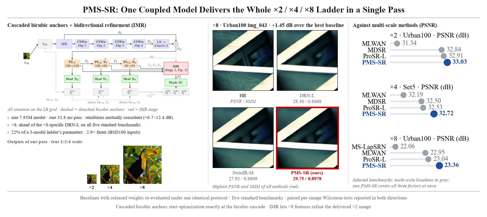
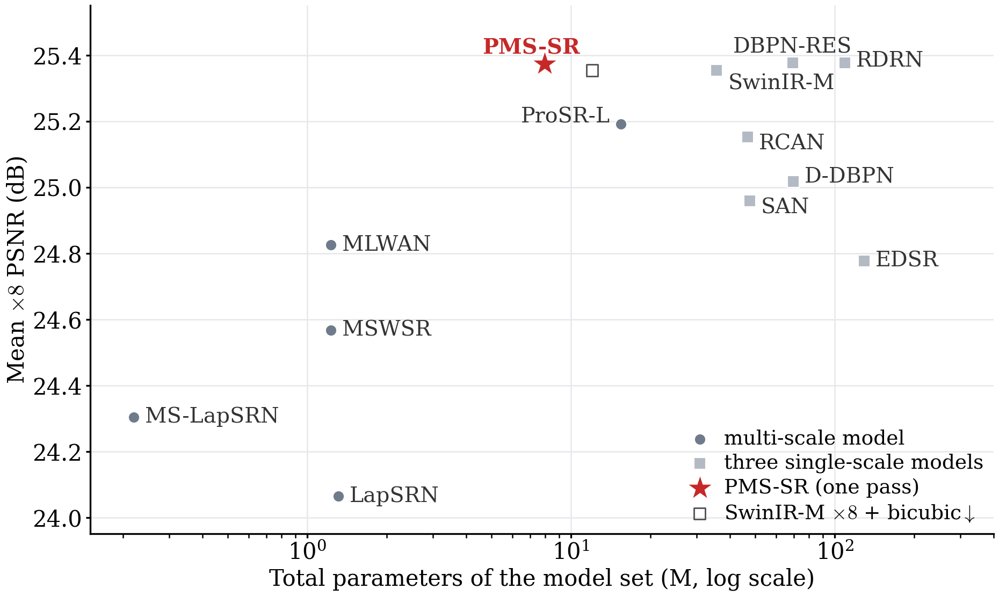
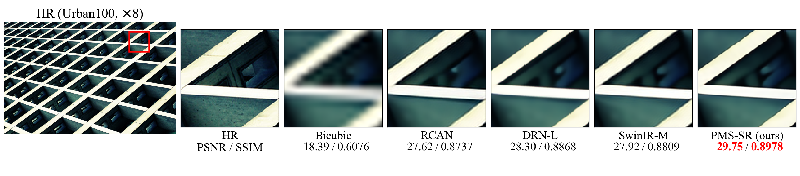
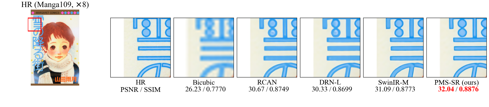
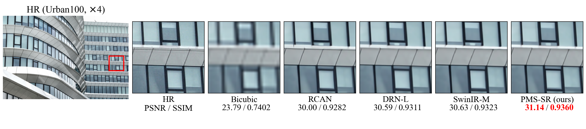

# PMS-SR: Progressive Multi-Scale Super-Resolution via Cascaded Bicubic Anchors and Inter-Scale Mutual Refinement

[Chun-An Lin](https://orcid.org/0009-0004-8874-6196), Yu-Chia Chang, Chi-Mao Fan, [Yen-Chieh Ouyang](https://orcid.org/0000-0002-4221-2787), [Tsung-Jung Liu](https://orcid.org/0000-0003-4296-0942)

National Chung Hsing University · Providence University · ASUSTeK Computer Inc., Taiwan

[](https://arxiv.org/abs/2611.03390)
[]()
[]()

One 7.95M-parameter model produces the ×2, ×4, and ×8 results of an input in a single forward pass. It has the highest PSNR among the compared multi-scale methods in every ×4 and ×8 entry. At ×8 it outperforms the ×8-specific DRN-L on all five standard benchmarks, gives the best Urban100 result among the compared methods, and stays within 0.13 dB of the strongest ×8-specific models elsewhere.



## Highlights

- **One pass, three outputs.** A single forward pass delivers ×2, ×4, and ×8. It uses 22% of the parameters of three single-scale SwinIR-M models and runs 2.9× faster on BSD100-sized inputs (32.8 ms vs. 94.4 ms on an RTX 4090).
- **Cascaded bicubic anchors.** Each scale is a residual over the detached bicubic upsampling of the previous scale's prediction. With Dirac and zero initialization, training starts exactly from the bicubic cascade. Replacing the cascade with a direct anchor costs 2.4 dB at ×8 on BSD100.
- **Inter-scale mutual refinement (IMR).** Space-to-depth feedback, deformable cross-scale alignment, and per-pixel fusion let the scales exchange information in both directions, so ×8 features also refine the ×2 output. The whole ×8 refinement runs on the ×4 grid.
- **Consistent renditions.** The three outputs agree 6.7–12.4 dB more closely than those of three independently trained models, reported together with degenerate controls.

## Results at ×8 (Y-PSNR / SSIM)

| Method | Params | Set5 | Set14 | BSD100 | Urban100 | Manga109 |
|---|---|---|---|---|---|---|
| RCAN | 15.7M | 27.31 / 0.7878 | 25.23 / 0.6511 | 24.98 / 0.6058 | 23.00 / 0.6452 | 25.24 / 0.8029 |
| DRN-L&dagger; | 10.0M | 27.42 / 0.7920 | 25.28 / 0.6528 | 25.01 / 0.6059 | 22.98 / 0.6434 | 25.32 / 0.8060 |
| DBPN-RES-MR64-3 | 23.1M | 27.51 / 0.793 | 25.41 / **0.657** | 25.05 / 0.607 | 23.20 / 0.652 | **25.71** / 0.813 |
| SwinIR-M | 12.1M | **27.55** / 0.7941 | **25.46** / 0.6568 | 25.04 / 0.6092 | 23.17 / 0.6547 | 25.55 / **0.8132** |
| RDRN | ≈36.4M | 27.52 / **0.7953** | 25.40 / 0.6548 | **25.10** / 0.6084 | 23.20 / 0.6511 | 25.66 / 0.8114 |
| **PMS-SR (one pass)** | 7.95M* | 27.49 / 0.7922 | 25.37 / 0.6551 | 25.07 / **0.6094** | **23.36** / **0.6593** | 25.58 / 0.8129 |
| PMS-SR+ (self-ensemble, not ranked) | 7.95M* | 27.54 / 0.7935 | 25.44 / 0.6568 | 25.11 / 0.6103 | 23.46 / 0.6623 | 25.75 / 0.8158 |

<sub>*One model covers all three factors. &dagger;Measured by us from the officially released weights under the same protocol; all other rows are published results (SwinIR-M ×8 from its supplementary material; RDRN size reported for its ×4 model). Bold marks the best single-model value in each column. The paper also gives the ×2 and ×4 tables, the comparison with multi-scale methods, paired per-image statistics, ablations, and complexity.</sub>

### PSNR gap to SwinIR-M across factors

| Benchmark | ×2 | ×4 | ×8 |
|---|---|---|---|
| Set5 | −0.26 | −0.20 | −0.06 |
| Set14 | −0.51 | −0.09 | −0.09 |
| BSD100 | −0.22 | −0.05 | **+0.03** |
| Urban100 | −0.78 | −0.20 | **+0.19** |
| Manga109 | −1.00 | −0.34 | **+0.03** |
| Average | −0.55 | −0.18 | **+0.02** |

<sub>Published SwinIR-M values (×8 from its supplementary material). The gap never widens with the factor on any benchmark; at ×8 only the Urban100 difference is statistically significant in our paired per-image test.</sub>

### One network instead of a three-model ladder



<sub>Single-scale methods count as three models; where only one size is reported, it is tripled (values from the paper's Tables I and III).</sub>

## Visual results

Urban100 img_043, ×8 (+1.45 dB over the best baseline):



Manga109 *YukiNoFuruMachi*, ×8:



Urban100 img_052, ×4:



## Evaluation protocol

- MATLAB-bicubic degradation; Y-channel PSNR/SSIM with a border of *s* pixels removed at scale *s*.
- Baselines with released weights (SwinIR-M, RCAN, DRN-L, MDSR, MSWSR, ProSR-L) were re-evaluated under the same protocol.
- Paired per-image Wilcoxon signed-rank tests with Holm correction are reported where PMS-SR loses as well as where it wins.
- A DIV2K-only control with one third of the schedule separates the effect of the architecture from that of the training data.

## Code and models

The training and evaluation code and the pretrained weights will be released in this repository after the paper is accepted.

## Citation

```bibtex
@misc{lin2026progressivemultiscalesuperresolutioncascaded,
      title={Progressive Multi-Scale Super-Resolution via Cascaded Bicubic Anchors and Inter-Scale Mutual Refinement}, 
      author={Chun-An Lin and Yu-Chia Chang and Chi-Mao Fan and Yen-Chieh Ouyang and Tsung-Jung Liu},
      year={2026},
      eprint={2611.03390},
      archivePrefix={arXiv},
      primaryClass={cs.CV},
      url={https://arxiv.org/abs/2611.03390}, 
}
```

## Acknowledgment

This work was supported in part by the National Science and Technology Council, Taiwan, under Grant NSTC 114-2221-E-005-040-MY2.
